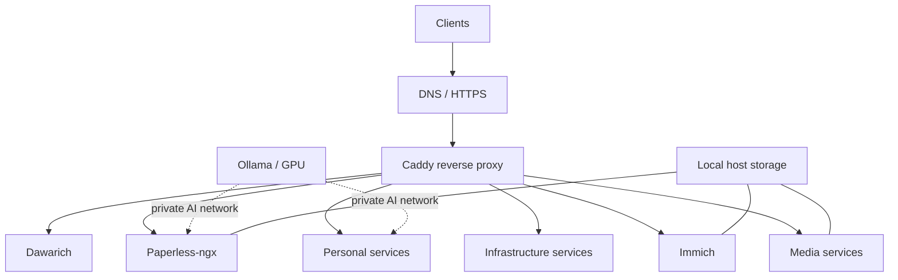

# Homelab

A production-style, self-hosted homelab running on **Fedora Linux**, managed with **Docker Compose** and fronted by **Caddy**. It brings together media automation, private services, monitoring, document management, and GPU-accelerated workloads.

> **Portfolio / reference configuration.** This repository documents one real deployment, not a turn-key installer. It requires your own host paths, credentials, domain/DNS, networking, and hardware-specific settings. No application databases, private media, or credentials should be committed.

## Highlights

- **Infrastructure as code:** six logically separated Compose projects, explicit container version tags (some digest-pinned), and shared networks.
- **Reverse proxy:** Caddy routes HTTPS traffic to explicitly configured services.
- **Observability:** Uptime Kuma, AutoKuma, Glances, Beszel, Dozzle, and Speedtest Tracker.
- **Media:** Jellyfin, Radarr, Sonarr, Prowlarr, qBittorrent, Bazarr, and the separately developed [SimpleSubGen](https://github.com/Kalinka98/SimpleSubGen).
- **Personal services:** Actual Budget, Vaultwarden, Homepage, Mealie, Zimi, and DVinyl.
- **Data and location:** Immich, Paperless-ngx, and Dawarich.
- **Local AI:** Ollama and NVIDIA GPU-enabled containers where appropriate.

## Architecture



The public-facing reverse proxy uses the external Docker network `homelab-edge`. Services requiring local language models use `homelab-ai`. Database and application-only networks are scoped to their relevant Compose projects where defined.

## Repository layout

| Path | Contents |
| --- | --- |
| `infrastructure/` | Caddy, networking, DNS, monitoring, notification, and Ollama services |
| `media/` | Jellyfin, media automation, downloads, and SimpleSubGen |
| `services/` | Homepage, Actual, Vaultwarden, Mealie, Zimi, DVinyl, and additional apps |
| `immich/` | Immich server, machine learning, database, and cache |
| `dawarich/` | Location-history service and dependencies |
| `paperless/` | Paperless-ngx, PostgreSQL, Valkey, Tika, and Gotenberg |

## Project links

Upstream repositories for the services and direct dependencies configured here.
Applications with multiple containers share the same project link.

| Stack | Projects |
| --- | --- |
| Infrastructure | [Caddy](https://github.com/caddyserver/caddy), [AdGuard Home](https://github.com/AdguardTeam/AdGuardHome), [Uptime Kuma](https://github.com/louislam/uptime-kuma), [Sockguard](https://github.com/CodesWhat/sockguard), [AutoKuma](https://github.com/BigBoot/AutoKuma), [Dozzle](https://github.com/amir20/dozzle), [Speedtest Tracker](https://github.com/alexjustesen/speedtest-tracker), [ntfy](https://github.com/binwiederhier/ntfy), [Homelable](https://github.com/Pouzor/homelable), [Beszel](https://github.com/henrygd/beszel), [Glances](https://github.com/nicolargo/glances), [Ollama](https://github.com/ollama/ollama) |
| Media | [Jellyfin](https://github.com/jellyfin/jellyfin), [Radarr](https://github.com/Radarr/Radarr), [Sonarr](https://github.com/Sonarr/Sonarr), [qBittorrent](https://github.com/qbittorrent/qBittorrent), [Prowlarr](https://github.com/Prowlarr/Prowlarr), [FlareSolverr](https://github.com/FlareSolverr/FlareSolverr), [Bazarr](https://github.com/morpheus65535/bazarr), [SimpleSubGen](https://github.com/Kalinka98/SimpleSubGen) |
| Personal services | [Actual Budget](https://github.com/actualbudget/actual), [Vaultwarden](https://github.com/dani-garcia/vaultwarden), [Homepage](https://github.com/gethomepage/homepage), [local quotes service](services/quotes-service/), [Ovumcy](https://github.com/ovumcy/ovumcy-web), [Zimi](https://github.com/epheterson/Zimi), [Mealie](https://github.com/mealie-recipes/mealie), [DVinyl](https://github.com/Kyonew/DVinyl), [MongoDB](https://github.com/mongodb/mongo) |
| Photos | [Immich](https://github.com/immich-app/immich), [PostgreSQL](https://github.com/postgres/postgres), [Valkey](https://github.com/valkey-io/valkey) |
| Location history | [Dawarich](https://github.com/Freika/dawarich), [Redis](https://github.com/redis/redis), [PostGIS](https://github.com/postgis/postgis), [PostgreSQL](https://github.com/postgres/postgres) |
| Documents | [Paperless-ngx](https://github.com/paperless-ngx/paperless-ngx), [PostgreSQL](https://github.com/postgres/postgres), [Valkey](https://github.com/valkey-io/valkey), [Gotenberg](https://github.com/gotenberg/gotenberg), [Apache Tika](https://github.com/apache/tika) |

Supporting tools, dashboard resources, and models are linked below. Model and
dataset pages point to their original publishers where they are hosted outside
GitHub.

| Component | Projects |
| --- | --- |
| Host and container runtime | [Fedora Linux](https://fedoraproject.org/), [Docker Engine / Moby](https://github.com/moby/moby), [Docker CLI](https://github.com/docker/cli), [Docker Compose](https://github.com/docker/compose), [NVIDIA Container Toolkit](https://github.com/NVIDIA/nvidia-container-toolkit) |
| Automation | [Git](https://github.com/git/git), [GNU Make](https://www.gnu.org/software/make/), [GitHub Actions checkout](https://github.com/actions/checkout) |
| Quotes service and exporter | [Python](https://github.com/python/cpython), [FastAPI](https://github.com/fastapi/fastapi), [Uvicorn](https://github.com/Kludex/uvicorn), [Hugging Face Datasets](https://github.com/huggingface/datasets) |
| Dashboard resources | [Open-Meteo](https://github.com/open-meteo/open-meteo), [Dashboard Icons](https://github.com/homarr-labs/dashboard-icons), [Material Design Icons](https://github.com/Templarian/MaterialDesign) |
| Speech recognition | [Whisper](https://github.com/openai/whisper), configured with `large-v3` |
| Translation | [NLLB / fairseq](https://github.com/facebookresearch/fairseq), [NLLB-200 distilled 600M model](https://huggingface.co/facebook/nllb-200-distilled-600M) |
| Document AI | [Qwen3-VL](https://github.com/QwenLM/Qwen3-VL), configured as `qwen3-vl:8b-instruct`; [EmbeddingGemma](https://huggingface.co/google/embeddinggemma-300m) |
| Quotes data | [Sanitized English Quotes](https://huggingface.co/datasets/tengomucho/english_quotes_sanitized), [original English Quotes](https://huggingface.co/datasets/Abirate/english_quotes); attribution in [third-party notices](THIRD_PARTY_NOTICES.md) |

<details>
<summary>Container image source repositories</summary>

Some image definitions live separately from their application's source code.

| Images | Source repositories |
| --- | --- |
| Caddy and Python base image | [Caddy Docker](https://github.com/caddyserver/caddy-docker), [Python official image](https://github.com/docker-library/python) |
| LinuxServer media images | [Radarr](https://github.com/linuxserver/docker-radarr), [Sonarr](https://github.com/linuxserver/docker-sonarr), [qBittorrent](https://github.com/linuxserver/docker-qbittorrent), [Prowlarr](https://github.com/linuxserver/docker-prowlarr), [Bazarr](https://github.com/linuxserver/docker-bazarr) |
| LinuxServer Speedtest Tracker | [Speedtest Tracker image](https://github.com/linuxserver/docker-speedtest-tracker) |
| Database images | [PostgreSQL](https://github.com/docker-library/postgres), [MongoDB](https://github.com/docker-library/mongo), [Redis](https://github.com/redis/docker-library-redis), [Valkey](https://github.com/valkey-io/valkey-container), [PostGIS](https://github.com/postgis/docker-postgis) |
| Immich PostgreSQL image and extensions | [Image definitions](https://github.com/immich-app/base-images/tree/main/postgres), [VectorChord](https://github.com/supervc-stack/VectorChord), [pgvector](https://github.com/pgvector/pgvector), [pgvecto.rs](https://github.com/tensorchord/pgvecto.rs) |
| Apache Tika image | [Tika Docker](https://github.com/apache/tika-docker) |

</details>

## Requirements

- Fedora Linux or another Linux host with Docker Engine and the Docker Compose plugin.
- A configured DNS domain and HTTPS-capable ingress if you choose remote access.
- Suitable volumes/directories for persistent state and user data.
- An NVIDIA GPU with compatible drivers and NVIDIA Container Toolkit **for services requesting GPU resources**; these Compose files are not fully CPU-only out of the box.
- Appropriate firewall and application authentication configuration.

## Getting started

These steps show how to inspect and adapt the configuration, **not** how to safely deploy every service unchanged.

1. Clone the repository.
2. Create the two shared networks (once):

   ```bash
   docker network create homelab-edge
   docker network create homelab-ai
   ```

3. For each stack, copy its environment template and then replace *every* placeholder with real values appropriate for your system:

   ```bash
   umask 077
   for stack in infrastructure media services immich dawarich paperless; do
     cp -n "$stack/.env.example" "$stack/.env"
   done
   ```

4. Follow the [configuration guide](docs/CONFIGURATION.md) for credential formats, shared storage paths, ownership, and Fedora/SELinux setup. Review bind mounts, the Docker socket, ports, domain names, user/group IDs, and GPU reservations.
5. Check interpolation without deploying containers:

   ```bash
   make validate
   ```

6. Start the infrastructure stack **only after** configuring its environment and security controls:

   ```bash
   cd infrastructure
   docker compose up -d
   ```

7. Start other stacks individually from their own directories once configured. Running `make up` validates all six local configurations before bringing up **all** stacks and is intended only for a prepared machine. Configuration validation does not guarantee that images, networks, hardware, or running applications are ready.

For CI or to validate the **published example values** without local `.env` files, run `make validate-examples`.

## Configuration and persistent state

All secrets, host-specific paths, authentication information, and private calendar feed URLs belong in ignored `.env` files or a dedicated secret manager. The tracked `*.env.example` files contain **nonworking placeholders**, never production credentials.

Required paths, domains, IDs, and authentication settings reject unset or empty
values during Compose interpolation. This does not validate secret strength,
formats, or placeholder values. Use the same `DATA_PATH`, `MOVIES_PATH`, and
`TVSHOWS_PATH` across stacks where they refer to the same storage. Homepage
service links follow the `BASE_DOMAIN` set in `services/.env`.

The [configuration guide](docs/CONFIGURATION.md) explains which values are shared,
which credentials come from applications, and how storage ownership and SELinux
labels apply to the different containers.

The deployment uses bind mounts and some named volumes for persistent state. Important data includes media libraries, passwords, private photographs, documents, databases, location history, and application configuration. It must **not** be pushed to Git. Backups, restore tests, and data retention policies must be arranged independently of the repository.

## Security model and tradeoffs

- Only explicitly routed services should be accessible through Caddy; a reverse proxy is **not** by itself an authentication mechanism.
- Internet-exposed management applications should use strong authentication and ideally an additional access control layer or VPN.
- Several observability integrations need Docker API/host information. Access to `/var/run/docker.sock`, including read-only mounts, is highly privileged; Docker socket consumers should be reviewed and constrained.
- AutoKuma uses a separately defined, allowlisted Docker API proxy for monitoring. Its HTTP access is restricted to its internal Docker network; it is not intended for internet exposure.
- The networking scanner is host-networked, so the scanner range and host firewall need explicit review.
- Host bind mount paths and hardcoded internal assumptions are tailored to this installation and may need adaptation on another machine.

## Validation

```bash
make validate-examples  # no real credentials required
make validate           # validates configured, local .env files
```

A GitHub Actions workflow validates all six Compose files against the example configurations on pushes and pull requests. This verifies Compose syntax/interpolation, **not** application startup or security posture.

## Third-party software and data

Original code, configuration, and documentation are available under the
[MIT license](LICENSE). Third-party applications, images, models, and the
bundled quotes dataset retain their separate terms. See
[third-party notices](THIRD_PARTY_NOTICES.md) for dataset provenance,
attribution, transformations, and the bundled export's checksum.

## Acknowledgements

Thank you to the maintainers and contributors behind the [projects listed above](#project-links).
Their applications, tools, models, documentation, and continued maintenance make
this homelab possible. Special thanks to [LinuxServer.io](https://github.com/linuxserver)
for the container images used in the media stack and for Speedtest Tracker.

Credit for the quotes data goes to
[Abir ELTAIEF / Abirate](https://huggingface.co/datasets/Abirate/english_quotes)
for the original dataset and
[tengomucho](https://huggingface.co/datasets/tengomucho/english_quotes_sanitized)
for the sanitized version. See the [third-party notices](THIRD_PARTY_NOTICES.md)
for provenance, transformations, and licensing information.

## Project status

This is an actively maintained personal deployment. Its configuration is provided for learning and reference, **not** as a security-hardened, copy-and-run deployment. Sensitive services, system-specific paths, and version upgrades require independent review.
