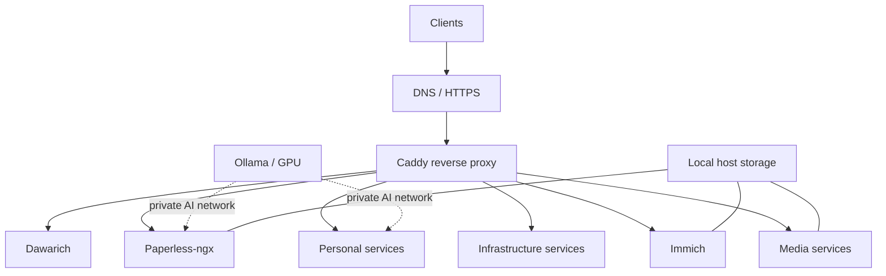

# Homelab

A production-style, self-hosted homelab running on **Fedora Linux**, managed with **Docker Compose** and fronted by **Caddy**. It brings together media automation, private services, monitoring, document management, and GPU-accelerated workloads.

> **Portfolio / reference configuration.** This repository documents one real deployment, not a turn-key installer. It requires your own host paths, credentials, domain/DNS, networking, and hardware-specific settings. No application databases, private media, or credentials should be committed.

## Highlights

- **Infrastructure as code:** six logically separated Compose projects, pinned container versions, and shared networks.
- **Reverse proxy:** Caddy routes HTTPS traffic to explicitly configured services.
- **Observability:** Uptime Kuma, AutoKuma, Glances, Beszel, Dozzle, and Speedtest Tracker.
- **Media:** Jellyfin, Radarr, Sonarr, Prowlarr, qBittorrent, Bazarr, and the separately developed [SimpleSubGen](https://github.com/Kalinka98/SimpleSubGen).
- **Personal services:** Actual Budget, Vaultwarden, Homepage, Mealie, Zimi, and DVinyl.
- **Data and location:** Immich, Paperless-ngx, and Dawarich.
- **Local AI:** Ollama and NVIDIA GPU-enabled containers where appropriate.

## Architecture



The public-facing reverse proxy uses the external Docker network `homelab-edge`. Services requiring local language models use `homelab-ai`. Database and application-only networks are scoped to their relevant Compose projects where defined.

## Repository layout

| Path | Contents |
| --- | --- |
| `infrastructure/` | Caddy, networking, DNS, monitoring, notification, and Ollama services |
| `media/` | Jellyfin, media automation, downloads, and SimpleSubGen |
| `services/` | Homepage, Actual, Vaultwarden, Mealie, Zimi, DVinyl, and additional apps |
| `immich/` | Immich server, machine learning, database, and cache |
| `dawarich/` | Location-history service and dependencies |
| `paperless/` | Paperless-ngx, PostgreSQL, Valkey, Tika, and Gotenberg |

## Requirements

- Fedora Linux or another Linux host with Docker Engine and the Docker Compose plugin.
- A configured DNS domain and HTTPS-capable ingress if you choose remote access.
- Suitable volumes/directories for persistent state and user data.
- An NVIDIA GPU with compatible drivers and NVIDIA Container Toolkit **for services requesting GPU resources**; these Compose files are not fully CPU-only out of the box.
- Appropriate firewall and application authentication configuration.

## Getting started

These steps show how to inspect and adapt the configuration, **not** how to safely deploy every service unchanged.

1. Clone the repository.
2. Create the two shared networks (once):

   ```bash
   docker network create homelab-edge
   docker network create homelab-ai
   ```

3. For each stack, copy its environment template and then replace *every* placeholder with real values appropriate for your system:

   ```bash
   for stack in infrastructure media services immich dawarich paperless; do
     cp -n "$stack/.env.example" "$stack/.env"
   done
   ```

4. Review all Compose settings, notably bind mounts, the Docker socket, ports, domain names, user/group IDs, and GPU reservations.
5. Check interpolation without deploying containers:

   ```bash
   make validate
   ```

6. Start the infrastructure stack **only after** configuring its environment and security controls:

   ```bash
   cd infrastructure
   docker compose up -d
   ```

7. Start other stacks individually from their own directories once configured. Running `make up` brings up **all** stacks and is intended only for a prepared machine.

For CI or to validate the **published example values** without local `.env` files, run `make validate-examples`.

## Configuration and persistent state

All secrets, host-specific paths, authentication information, and private calendar feed URLs belong in ignored `.env` files or a dedicated secret manager. The tracked `*.env.example` files contain **nonworking placeholders**, never production credentials.

The deployment uses bind mounts and some named volumes for persistent state. Important data includes media libraries, passwords, private photographs, documents, databases, location history, and application configuration. It must **not** be pushed to Git. Backups, restore tests, and data retention policies must be arranged independently of the repository.

## Security model and tradeoffs

- Only explicitly routed services should be accessible through Caddy; a reverse proxy is **not** by itself an authentication mechanism.
- Internet-exposed management applications should use strong authentication and ideally an additional access control layer or VPN.
- Several observability integrations need Docker API/host information. Access to `/var/run/docker.sock`, including read-only mounts, is highly privileged; Docker socket consumers should be reviewed and constrained.
- AutoKuma uses a separately defined, allowlisted Docker API proxy for monitoring. Its HTTP access is restricted to its internal Docker network; it is not intended for internet exposure.
- The networking scanner is host-networked, so the scanner range and host firewall need explicit review.
- Host bind mount paths and hardcoded internal assumptions are tailored to this installation and may need adaptation on another machine.
- The repository and previous Git commits must be scanned for credentials **before publication**.

## Validation

```bash
make validate-examples  # no real credentials required
make validate           # validates configured, local .env files
```

A GitHub Actions workflow validates all six Compose files against the example configurations on pushes and pull requests. This verifies Compose syntax/interpolation, **not** application startup or security posture.

## Third-party software and data

This repository **configures** third-party containers; it does not own their source code or licenses. The quotes service currently uses a dataset derived from [tengomucho/english_quotes_sanitized](https://huggingface.co/datasets/tengomucho/english_quotes_sanitized), itself derived from [Abirate/english_quotes](https://huggingface.co/datasets/Abirate/english_quotes), whose dataset card lists CC BY 4.0. Attribution does not independently establish rights to every underlying quotation.

Licensing of this repository's original files is separate from third-party dependencies and data.

## Project status

This is an actively maintained personal deployment. Its configuration is provided for learning and reference, **not** as a security-hardened, copy-and-run deployment. Sensitive services, system-specific paths, and version upgrades require independent review.
