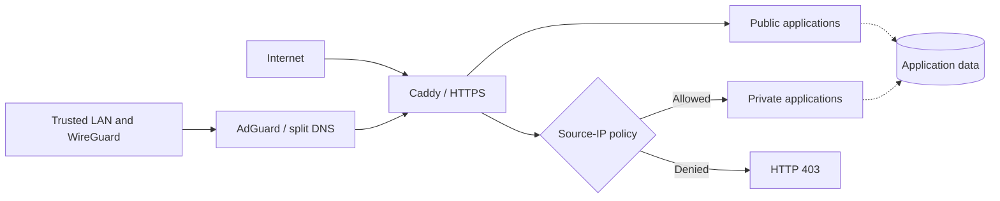

<h1 align="center">Homelab</h1>

<p align="center"><strong>A self-hosted platform for everyday services, media, monitoring, and local AI.</strong></p>

<p align="center">Fedora Linux · Docker Compose · Caddy · WireGuard · NVIDIA GPU</p>

<p align="center">
  <a href="https://github.com/Kalinka98/homelab/actions/workflows/validate.yml"></a>
  <a href="LICENSE"></a>
</p>

<p align="center">
  <a href="#architecture">Architecture</a> · <a href="#engineering-highlights">Engineering highlights</a> · <a href="#stacks">Stacks</a> · <a href="#documentation">Documentation</a>
</p>

---

## Overview

This repository contains the configuration and tooling behind my personal homelab: **six independently managed Docker Compose stacks**, a shared HTTPS entry point, private remote access, automated monitoring, and GPU-enabled services.

It is a real deployment and a technical portfolio project—not a one-command installer. Host paths, credentials, DNS, networking, and hardware settings must be adapted before use.

## Engineering highlights

| Area | Design and implementation |
| --- | --- |
| **Infrastructure** | Six separate Compose projects, versioned images, shared networks, and persistent data mounts. |
| **Networking** | Caddy reverse proxy, HTTPS, AdGuard split DNS, and router-hosted WireGuard for private remote access. |
| **Access control** | Public and LAN/VPN-only routes, enforced by Caddy source-IP policies; application authentication remains separate. |
| **Docker API security** | Dedicated, API-restricted Sockguard proxies for Dozzle and AutoKuma instead of unrestricted Docker socket access. |
| **Operations** | Uptime Kuma, AutoKuma, Beszel, Glances, Dozzle, and Speedtest Tracker for availability and diagnostics. |
| **Automation & AI** | NVIDIA GPU workloads for Jellyfin, SimpleSubGen, and local Ollama models; reusable Compose configuration checks. |

## Architecture



Selected applications are reachable publicly over HTTPS. Administrative and sensitive services require an authorized LAN or WireGuard source address **and** their own application-level authentication.

[Explore the architecture and tradeoffs →](docs/ARCHITECTURE.md) · [Review remote access and security →](docs/REMOTE_ACCESS.md)

## Stacks

| Directory | Purpose | Examples |
| --- | --- | --- |
| [`infrastructure/`](infrastructure/) | Ingress, DNS, monitoring, notifications, local AI | Caddy, AdGuard, Uptime Kuma, ntfy, Ollama |
| [`media/`](media/) | Media playback and automation | Jellyfin, Sonarr, Radarr, SimpleSubGen |
| [`services/`](services/) | Personal applications and custom integrations | Homepage, Vaultwarden, Mealie, Actual, DVinyl |
| [`immich/`](immich/) | Photo and video management | Immich and its dependencies |
| [`dawarich/`](dawarich/) | Personal location history | Dawarich and its dependencies |
| [`paperless/`](paperless/) | Document management and OCR | Paperless-ngx, Tika, Gotenberg |

[Full service inventory and upstream projects →](docs/STACKS.md)

## Configuration validation

GitHub Actions checks all six Compose configurations, validates Caddy's configuration, and tests the expected public/private route classification. These are **static checks**, not end-to-end deployment or security tests.

To validate the published examples without configuring or starting services:

```bash
make validate-examples
```

To deploy on a separate machine, start with the [deployment guide](docs/DEPLOYMENT.md); do **not** run the example configuration unchanged.

## Documentation

| Guide | Contents |
| --- | --- |
| [Architecture](docs/ARCHITECTURE.md) | Network topology, design decisions, limitations |
| [Service inventory](docs/STACKS.md) | Containers, applications, upstream credits |
| [Deployment](docs/DEPLOYMENT.md) | Prerequisites, setup sequence, validation |
| [Configuration](docs/CONFIGURATION.md) | Environment variables, secrets, storage, SELinux |
| [Remote access & security](docs/REMOTE_ACCESS.md) | WireGuard, split DNS, Caddy ACLs, verification |

## Scope and attribution

The work presented here is the **integration, configuration, security policy, automation, and maintenance** of the platform—not authorship of the third-party applications it runs. My separate [SimpleSubGen](https://github.com/Kalinka98/SimpleSubGen) project is used in the media stack; this repository also includes a small local quotes service.

Original repository content is [MIT-licensed](LICENSE). Third-party software, models, images, and data retain their own terms; see [third-party notices](THIRD_PARTY_NOTICES.md).
