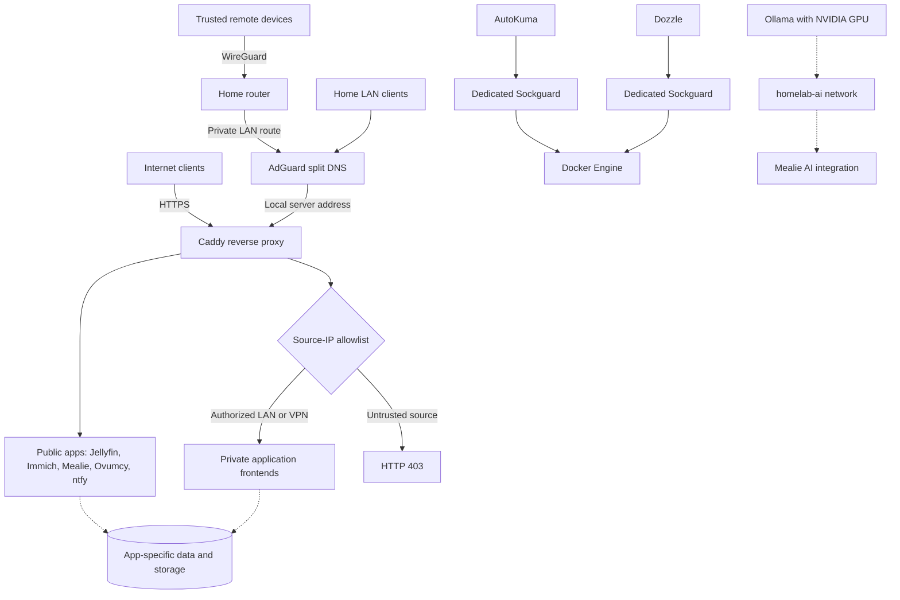

# Architecture and design decisions

[← README](../README.md) · [Deployment](DEPLOYMENT.md) · [Remote access and security](REMOTE_ACCESS.md)

## Goals and constraints

The platform brings together self-hosted applications without placing their administration surfaces openly on the internet. It prioritizes maintainability, repeatable configuration checks, explicit storage paths, and separation between frontend, database, and Docker API access. It is a **single-host personal deployment**, not a high-availability cluster or a turnkey hardened product.

## Request paths

### Public and private services

Public HTTPS routes include Jellyfin, Immich, Mealie, Ovumcy, and ntfy. Sensitive applications—such as Homepage, media management, monitoring, Vaultwarden, Paperless, and Dawarich—are restricted to clients connecting from authorized LAN or WireGuard addresses.

**The boundary is Caddy's HTTP access policy, not split DNS.** DNS is used for convenient local routing; application authentication and authorization are still required behind the reverse proxy. The policy assumes Caddy sees distinguishable client source addresses. Changes to upstream proxies, router behavior, IPv6 paths, or Docker networking require revalidation.

For the exact route classification and test matrix, see [Remote access and network security](REMOTE_ACCESS.md).

## Compose and network boundaries

| Layer | Purpose |
| --- | --- |
| Six Compose projects | Infrastructure, media, services, Immich, Dawarich, and Paperless can be managed separately. |
| `homelab-edge` | Shared external bridge network connecting Caddy to application frontends. |
| `homelab-ai` | Shared external bridge network for services intentionally using the Ollama endpoint. |
| Application-specific networks | Keep databases and internal dependencies off the shared ingress network where practical. |
| Bind mounts / named volumes | Preserve application state across container recreation. |

The two shared external Docker networks must exist before starting their dependent stacks. Some databases are deliberately accessible only to other containers in their application network; this is not equivalent to host-level isolation or a firewall audit.

## Privileged integrations

Docker API access is particularly sensitive because even read-oriented access can expose container metadata and, depending on permitted endpoints, confidential information.

- AutoKuma and Dozzle connect through **separate Sockguard instances** with per-consumer API restrictions.
- Homepage and Glances do not receive a Docker socket mount.
- Glances retains host-process visibility and selected read-only storage mounts for monitoring.
- GPU-enabled containers use NVIDIA drivers and the NVIDIA Container Toolkit on the host. CPU-only deployment is **not** fully supported by these Compose files without edits.

See the actual policy files under `infrastructure/kuma-docker-api/` and `infrastructure/dozzle-docker-api/` rather than treating the network diagram as a security guarantee.

## Storage and application state

Data survives container recreation through bind mounts or named volumes, but **persistence is not backup**. The deployment contains sensitive application databases, document and image libraries, passwords, and location history. Those assets must remain outside version control and need an independently tested backup and restore process.

The tracked `.env.example` files use placeholders. Real secrets, private feed URLs, local paths, trusted CIDRs, and per-app credentials live in ignored `.env` files or a separate secret manager. [Configuration](CONFIGURATION.md) documents storage ownership and Fedora SELinux labels.

## Operations and checks

Monitoring combines availability (Uptime Kuma and AutoKuma), resource health (Beszel and Glances), logs (Dozzle), and network measurements (Speedtest Tracker).

The [GitHub Actions validation workflow](../.github/workflows/validate.yml) runs three configuration-level checks:

1. Docker Compose interpolation and syntax for all six stacks against tracked environment examples.
2. Caddy configuration validation, including imported site definitions.
3. A Python access-policy test for expected public/private route classification.

These checks do **not** establish that containers start, credentials work, sources are correctly identified in production, or the system is comprehensively secure. Integration smoke tests and restore testing remain separate operational responsibilities.

## Tradeoffs

| Decision | Benefit | Cost / limitation |
| --- | --- | --- |
| Docker Compose instead of orchestration cluster | Smaller operational footprint, readable configuration | Single host, manual recovery, no automatic failover |
| Selected public apps, private admin routes | Public usability without exposing administration by default | Must maintain and test Caddy allowlists and app security |
| Router-hosted WireGuard | No extra VPN container in the stack | Depends on router capabilities and correct client routing |
| Shared `homelab-edge` network | Simple, centralized reverse proxy | Application frontend isolation is coarser than per-app ingress networks |
| Versioned image tags | Easier review and controlled updates | Tags alone do not eliminate supply-chain risk or guarantee reproducibility |
| Local GPU acceleration | Private inference and media workloads | NVIDIA hardware dependency and shared GPU capacity |

This is a reference design for a personal homelab. Do not deploy it unchanged into another security environment.
